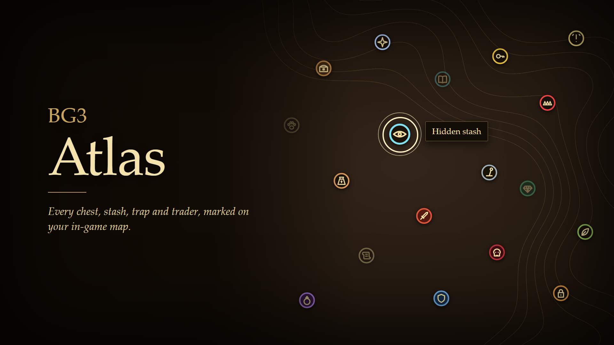
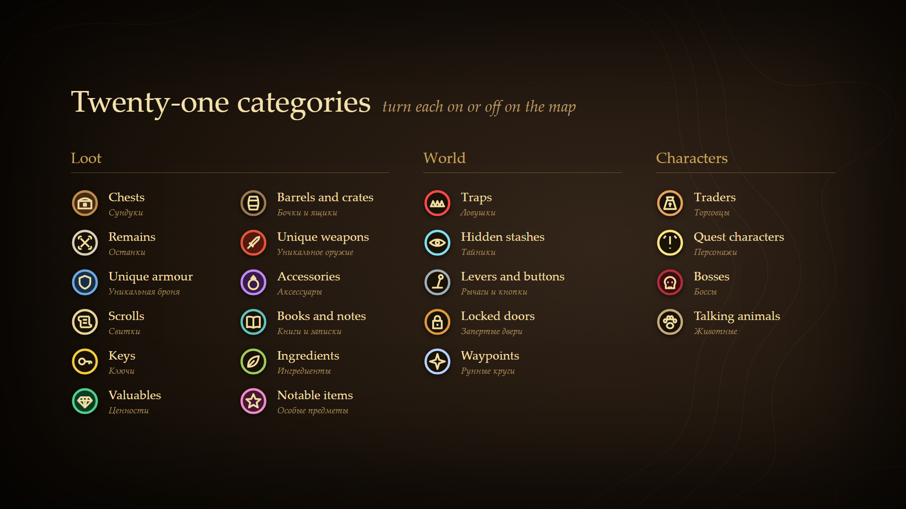

<div align="center">


# BG3 Atlas

### Every chest, stash, trap and trader. On your in-game map.

An interactive map mod for Baldur's Gate 3. Open the journal map or glance at the minimap and see<br/>
**chests · unique gear · books · keys · traps · hidden stashes · levers · waypoints · traders · bosses** with their own icons.

**No second monitor. No browser. All data comes from the game's own files.**

[**Download on Nexus Mods**](https://www.nexusmods.com/baldursgate3/mods/26685) &nbsp;·&nbsp;
[Install](#-install) &nbsp;·&nbsp;
[Controls](#-controls) &nbsp;·&nbsp;
[Build from source](#-build-from-source) &nbsp;·&nbsp;
[Spec](./docs/SPEC.md) &nbsp;·&nbsp;
[Roadmap](#-roadmap) &nbsp;·&nbsp;
[Contribute](#-contributing)

[](https://www.nexusmods.com/baldursgate3/mods/26685)
[](./LICENSE)
[](https://github.com/bvffblvde/BG3-Atlas/actions)
[](https://github.com/bvffblvde/BG3-Atlas/stargazers)
[](https://baldursgate3.game)
[](https://github.com/Norbyte/bg3se)
[](./CONTRIBUTING.md)
[](https://u24.gov.ua)

English · [Українська](./README.uk.md)

<br/>



</div>

---

## ✨ Why BG3 Atlas?

Map sites are great until you alt-tab for the hundredth time. BG3 Atlas puts the points **on the game's own map**, so you plan a route, check what you missed and keep playing.

- 🗺️ **On the real map.** Icons on the journal map and the minimap, sized like the game's markers and pinned while you zoom and pan.
- 🧭 **20 categories.** Turn each on or off, or show and hide all at once. Found / total counter per category.
- ✅ **Found tracking.** Looted containers, picked up items and defeated bosses are marked automatically. Mark or unmark any point yourself.
- 🔎 **Search.** Find a point by name in English or Russian.
- 🏰 **Sub maps.** Inside buildings, caves, the Underdark, Grymforge and the crypt you see only that place and floor.
- 🎮 **Gamepad and split screen.** Full controller support, each player has their own map view.
- 📦 **Game data only.** Points are extracted from the game files. Nothing is copied from map sites or other mods.

## 🎬 See it in action



In-game screenshots are coming with the first release.

## 🧩 Features

**Categories**
- Loot: `Chests` `Barrels and crates` `Remains` `Unique weapons` `Unique armour` `Accessories` `Scrolls` `Books and notes` `Keys` `Ingredients` `Valuables`
- World: `Traps` `Hidden stashes` `Levers and buttons` `Locked doors` `Waypoints`
- Characters: `Traders` `Quest characters` `Bosses` `Talking animals`

Barrels, crates and remains are off by default: there are thousands of them.

**Map**
- Icons on the journal map (mouse and gamepad pages) and the minimap
- Hover tooltip with the point's name, on a gamepad the name shows in the panel
- Found points are dimmed, or hidden with "Hide found"
- Waypoints use their real names ("Roadside Cliffs", "Last Light Inn", "Grey Harbour Docks")

**Coverage**
- Wilderness, Underdark and Grymforge, Shadow-Cursed Lands, Moonrise Towers, Rivington and Wyrm's Crossing, Lower City, plus the smaller areas

**Storage**
- Filters are global and apply to every save
- Found state is stored in the save itself

## 📥 Install

1. Install [BG3 Script Extender](https://github.com/Norbyte/bg3se).
2. Download the latest version from [Nexus Mods](https://www.nexusmods.com/baldursgate3/mods/26685) and put `BG3Atlas.pak` into `%LOCALAPPDATA%\Larian Studios\Baldur's Gate 3\Mods`.
3. Enable **BG3 Atlas** in your mod manager or the in-game mod manager and start the game.

Enable or disable the mod from the main menu, not while a save is loaded.

## 🎮 Controls

| Action | Mouse and keyboard | Gamepad |
|---|---|---|
| Open the Atlas panel | Open the journal map, the panel sits on it | Open the map, press the button shown next to "Legend" |
| Show or hide a category | Click it | D-pad to select, the "On/off" button in the hint bar |
| See a point's name | Hover the icon | Move the map cursor onto it, the name shows in the panel |
| Mark or unmark as found | Hover the icon and press `F` | The "Found" button in the hint bar |
| Search | Type in the search box | Not available |

`F` does nothing while you type in the search box.

<details>
<summary><b>Settings and console commands</b></summary>

Category filters, "Hide found" and "Explored only" are saved to
`%LOCALAPPDATA%\Larian Studios\Baldur's Gate 3\Script Extender\BG3Atlas\settings.json`.

In the Script Extender console:

```
!atlas_layerdump                     write a diagnostic dump of the map
!atlas_iconpx <journal> <minimap>    change icon size in pixels
!atlas_toggle <category>             toggle a category
!atlas_all on|off                    show or hide all categories
```

</details>

## ⚠️ Known limitations

- "Explored only" is work in progress: the game's fog of war is not readable by mods, so the filter may not hide anything yet.
- Automatic marking needs the object to be loaded near you. Items taken out of a container are not points of their own, the container is.
- Found marks in online multiplayer are kept per client and may overwrite each other. Single player and split screen are fine.
- Better Maps All-In-One and other mods that replace the same map files have not been tested.

## 🛠️ Build from source

Requires Windows, Node 22+, Baldur's Gate 3 installed through Steam and [LSLib](https://github.com/Norbyte/lslib/releases) unpacked into `tools/bin/lslib`.

```bash
git clone https://github.com/bvffblvde/BG3-Atlas.git
cd BG3-Atlas
npm install
npm run unpack     # unpack the needed game paks into work/unpacked (once)
npm run extract    # build data/points.json from the game files
npm run build      # build dist/BG3Atlas.pak
```

<details>
<summary><b>Scripts</b></summary>

```bash
npm test               # Vitest unit tests (tooling and Lua logic)
npm run install-mod    # copy the pak into the game's Mods folder, keeps your mod order
npx tsx tools/media.ts # regenerate README images from the mod's icons
```

Unpacked game files, built paks and generated data never go into git.

</details>

## 🏗️ How it works

```
 game .pak files
   └─▶ tools/unpack ──▶ tools/extract ──▶ data/points.json ──▶ tools/build ──▶ BG3Atlas.pak
                        levels, templates,                     Lua tables
                        localization, waypoints                + patched map XAML

 in game
   Lua (Script Extender) ──▶ filters · found state · search · sub map detection
   Noesis XAML layer     ──▶ icons on the map and minimap · Atlas panel · tooltips
```

The extractor reads level objects, root templates, tags and localization, sorts them into categories with tested rules (`tools/categories.ts`) and converts world coordinates to map coordinates per level and sub map. The mod adds one layer to the vanilla map styles and a panel to the journal map pages, so the game's own markers keep working.

<details>
<summary><b>Tech stack</b></summary>

TypeScript · Node · tsx · Vitest · fast-xml-parser · LSLib (Divine) · Lua · BG3 Script Extender · Noesis XAML · fengari (Lua tests)

</details>

## 🗺️ Roadmap

- [x] Recon: map UI, level data, world to map transform
- [x] Prototype points on the journal map
- [x] Data extractor with category rules and tests
- [x] All points, icons and filters on the map and minimap
- [x] Found tracking, manual marking, tooltips, search
- [x] Sub maps and all three acts
- [x] Gamepad and split screen
- [x] **v1.0**: [released on Nexus Mods](https://www.nexusmods.com/baldursgate3/mods/26685)
- [ ] Lower City basement points drawn on the surface map
- [ ] In-game testing of act 2, clean profile check
- [ ] "Explored only" filter that follows the fog of war
- [ ] Better Maps All-In-One compatibility

Have an idea or found a misplaced icon? [Open an issue](https://github.com/bvffblvde/BG3-Atlas/issues).

## 🌍 Translations

| Language | Translator |
|---|---|
| English | bvffblvde |
| Russian | bvffblvde |
| Brazilian Portuguese | [ShadowAhjin](https://www.nexusmods.com/profile/ShadowAhjin) |

Point names come from the game's own localization. Want to add your language? Copy `Client/Locale/en.lua`, translate the right side and open an issue or a pull request.

## 🤝 Contributing

Contributions are welcome. Category rules, map transforms and parsers are covered by tests, so most fixes start with a failing test in `tools/test`.

- 🐞 Misplaced or missing point: open an issue with the place, what you expected and a screenshot
- 🧭 Wrong category: the rules live in [`tools/categories.ts`](./tools/categories.ts)
- 🌍 Translation: interface strings live in `Client/Locale/<language>.lua`, one file per language

Please read [CONTRIBUTING.md](./CONTRIBUTING.md) first.

## ⭐ Support

If BG3 Atlas saves you an alt-tab or two, **give it a star**. It really helps the project get discovered.

<a href="https://star-history.com/#bvffblvde/BG3-Atlas&Date">
  
</a>

## 📄 License

[MIT](./LICENSE) © bvffblvde

<sub>BG3 Atlas is a fan made mod and is not affiliated with or endorsed by Larian Studios. Baldur's Gate 3 and all game content belong to their owners. This repository contains no game files. Not affiliated with Map Genie.</sub>

<div align="center">
<sub>Built with ☕ in Kharkiv, Ukraine 🇺🇦</sub>
</div>
