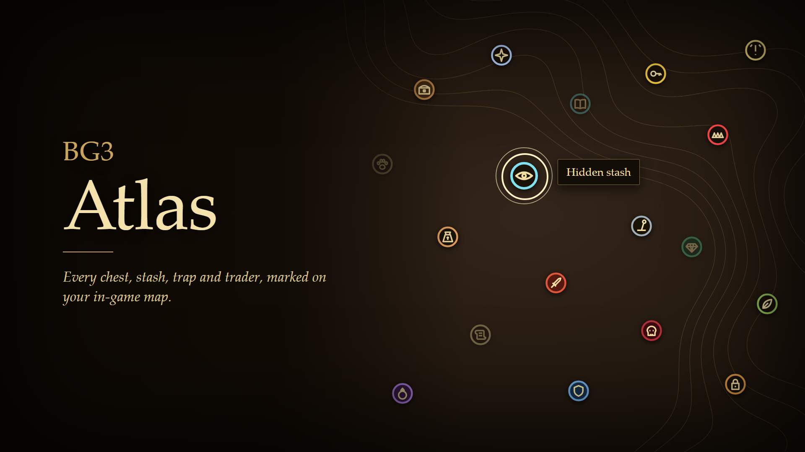
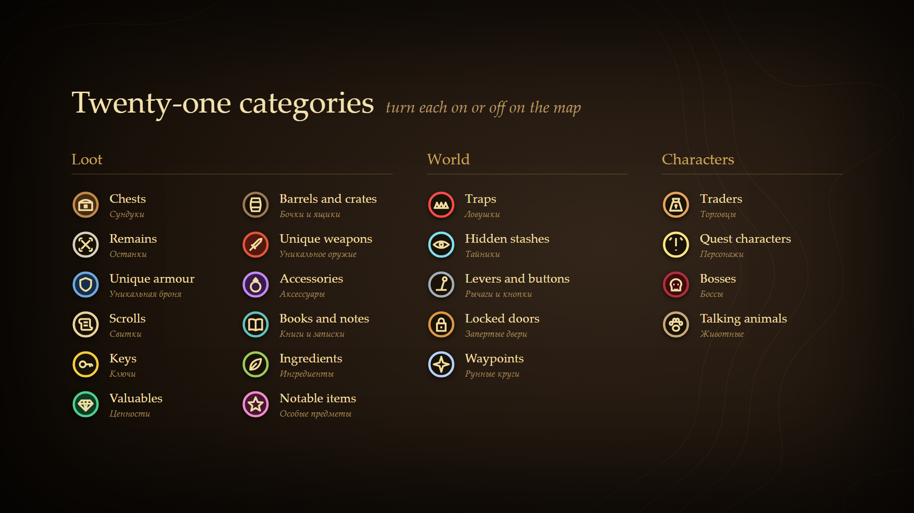

<div align="center">


# BG3 Atlas

### Кожна скриня, схованка, пастка й торговець. Просто на ігровій мапі.

Мод з інтерактивною мапою для Baldur's Gate 3. Відкрийте мапу журналу або гляньте на мінімапу й побачите<br/>
**скрині · унікальне спорядження · книги · ключі · пастки · схованки · важелі · рунні кола · торговців · босів** з власними іконками.

**Без другого монітора. Без браузера. Усі дані беруться з файлів самої гри.**

[**Завантажити на Nexus Mods**](https://www.nexusmods.com/baldursgate3/mods/26685) &nbsp;·&nbsp;
[Встановлення](#-встановлення) &nbsp;·&nbsp;
[Керування](#-керування) &nbsp;·&nbsp;
[Збірка з коду](#-збірка-з-коду) &nbsp;·&nbsp;
[Специфікація](./docs/SPEC.md) &nbsp;·&nbsp;
[Дорожня карта](#-дорожня-карта) &nbsp;·&nbsp;
[Долучитися](#-як-долучитися)

[](https://www.nexusmods.com/baldursgate3/mods/26685)
[](./LICENSE)
[](https://github.com/bvffblvde/BG3-Atlas/actions)
[](https://github.com/bvffblvde/BG3-Atlas/stargazers)
[](https://baldursgate3.game)
[](https://github.com/Norbyte/bg3se)
[](./CONTRIBUTING.md)
[](https://u24.gov.ua)

[English](./README.md) · Українська

<br/>



</div>

---

## ✨ Навіщо BG3 Atlas?

Сайти з мапами чудові, доки не перемикаєшся на браузер усоте. BG3 Atlas ставить точки **на власну мапу гри**: прокладаєте маршрут, перевіряєте, що пропустили, і граєте далі.

- 🗺️ **На справжній мапі.** Іконки на мапі журналу та мінімапі, розміром як ігрові маркери, не зсуваються під час масштабування.
- 🌫️ **Поважає туман війни.** Іконки приховані, доки ви не дослідите місцевість, один клік або `LB` показує все.
- 🧭 **21 категорія.** Вмикайте й вимикайте кожну окремо або всі разом. Лічильник «знайдено / усього» для кожної.
- ✅ **Облік знайденого.** Обшукані контейнери, підібрані предмети й переможені боси позначаються автоматично. Будь-яку точку можна позначити чи зняти позначку вручну.
- 🔎 **Пошук.** Знайдіть точку за назвою англійською або російською.
- 🏰 **Підмапи.** У будівлях, печерах, Підмор'ї, Ґримфорджі та склепі видно лише точки цього місця й поверху.
- 🎮 **Геймпад і розділений екран.** Повна підтримка контролера, у кожного гравця свій вигляд мапи.
- 📦 **Лише дані гри.** Точки витягнуто з файлів гри. Нічого не скопійовано з сайтів-мап чи інших модів.

## 🎬 Як це виглядає



Скриншоти з гри з'являться разом із першим релізом.

## 🧩 Можливості

**Категорії**
- Здобич: `Скрині` `Бочки й ящики` `Останки` `Унікальна зброя` `Унікальна броня` `Аксесуари` `Сувої` `Книги й записки` `Ключі` `Інгредієнти` `Цінності` `Особливі предмети`
- Світ: `Пастки` `Схованки` `Важелі й кнопки` `Замкнені двері` `Рунні кола`
- Персонажі: `Торговці` `Квестові персонажі` `Боси` `Тварини, що розмовляють`

Бочки, ящики та останки за замовчуванням вимкнені: їх тисячі. Особливі предмети: сюжетні й унікальні речі, які можна підняти і які не підходять до інших категорій, як-от кора суссуру, Noblestalk чи форми з Ґримфорджу.

**Мапа**
- Іконки на мапі журналу (сторінки для миші та геймпада) і мінімапі
- Підказка з назвою точки при наведенні, на геймпаді назва з'являється в панелі
- Знайдені точки тьмяніють або ховаються кнопкою «Сховати знайдене»
- Розмір панелі: звичайний, великий або дуже великий, підписи іконок ростуть разом із нею
- Можна сховати легенду мапи гри; великі розміри панелі ховають її самі
- Рунні кола підписані справжніми назвами («Roadside Cliffs», «Last Light Inn», «Grey Harbour Docks»)

**Охоплення**
- Дика місцевість, Підмор'я й Ґримфордж, Прокляті тінню землі, Місячні вежі, Ривінгтон і Переправа Змія, Нижнє місто та менші локації

**Збереження**
- Фільтри глобальні й діють у кожному збереженні
- Стан «знайдено» зберігається у самому збереженні

## 📥 Встановлення

1. Встановіть [BG3 Script Extender](https://github.com/Norbyte/bg3se).
2. Завантажте останню версію з [Nexus Mods](https://www.nexusmods.com/baldursgate3/mods/26685) і покладіть `BG3Atlas.pak` у `%LOCALAPPDATA%\Larian Studios\Baldur's Gate 3\Mods`.
3. Увімкніть **BG3 Atlas** у менеджері модів або вбудованому менеджері гри й запустіть гру.

Вмикайте й вимикайте мод у головному меню, а не із завантаженим збереженням.

## 🎮 Керування

| Дія | Миша й клавіатура | Геймпад |
|---|---|---|
| Відкрити панель Atlas | Відкрийте мапу журналу, панель уже на ній | Відкрийте мапу, натисніть кнопку біля «Legend» |
| Показати чи сховати категорію | Клацніть по ній | Хрестовина для вибору, кнопка «Увімк/вимк» у підказках |
| Дізнатися назву точки | Наведіть на іконку | Наведіть курсор мапи, назва з'явиться в панелі |
| Позначити чи зняти «знайдено» | Наведіть на іконку й натисніть `F` | Наведіть курсор мапи й натисніть `RB` |
| Лише досліджене чи всюди | Кнопка в панелі | `LB` |
| Стиль мапи: звичайна, без сітки, чиста | Кнопка в панелі | `LT` |
| Розмір панелі, легенда | Кнопки під категоріями | Хрестовиною вниз за категорії, далі кнопка «Увімк/вимк» |
| Пошук | Введіть у поле пошуку | Недоступний |

`F` не спрацьовує, поки ви друкуєте в полі пошуку.

<details>
<summary><b>Налаштування й консольні команди</b></summary>

Фільтри категорій, «Сховати знайдене» й «Лише досліджене» зберігаються в
`%LOCALAPPDATA%\Larian Studios\Baldur's Gate 3\Script Extender\BG3Atlas\settings.json`.

У консолі Script Extender:

```
!atlas_layerdump                     діагностичний дамп мапи
!atlas_iconpx <journal> <minimap>    розмір іконок у пікселях
!atlas_toggle <category>             перемкнути категорію
!atlas_all on|off                    показати чи сховати всі категорії
```

</details>

## ⚠️ Відомі обмеження

- Автопозначка працює, коли об'єкт завантажений поруч із вами. Предмети, вийняті з контейнера, не є окремими точками, точкою є сам контейнер.
- В онлайн-кооперативі позначки зберігаються в кожного клієнта окремо й можуть перезаписувати одна одну. Одиночна гра й розділений екран працюють коректно.
- Better Maps All-In-One від Caites: Better Map Icons працює. З Better Map (версії з масштабом) ставте BG3 Atlas **нижче** нього в порядку завантаження, інакше панель Atlas не з'явиться. Clear Map замінює весь шаблон мапи й ховає іконки Atlas: приберіть його й перемкніть стиль мапи в панелі Atlas (або `LT`): «без сітки» або «чиста» (без сітки й з прозорим туманом).
- Mazzle's Maps Unleashed працює разом з BG3 Atlas.

## 🛠️ Збірка з коду

Потрібні Windows, Node 22+, Baldur's Gate 3 зі Steam і [LSLib](https://github.com/Norbyte/lslib/releases), розпакований у `tools/bin/lslib`.

```bash
git clone https://github.com/bvffblvde/BG3-Atlas.git
cd BG3-Atlas
npm install
npm run unpack     # розпакувати потрібні паки гри у work/unpacked (один раз)
npm run extract    # зібрати data/points.json з файлів гри
npm run build      # зібрати dist/BG3Atlas.pak
```

<details>
<summary><b>Скрипти</b></summary>

```bash
npm test               # юніт-тести Vitest (тулінг і логіка на Lua)
npm run install-mod    # скопіювати пак у папку Mods, порядок модів не змінюється
npx tsx tools/media.ts # перегенерувати зображення README з іконок мода
```

Розпаковані файли гри, зібрані паки й згенеровані дані ніколи не потрапляють у git.

</details>

## 🏗️ Як це працює

```
 файли гри .pak
   └─▶ tools/unpack ──▶ tools/extract ──▶ data/points.json ──▶ tools/build ──▶ BG3Atlas.pak
                        рівні, шаблони,                        Lua-таблиці
                        локалізація, рунні кола                + пропатчений XAML мапи

 у грі
   Lua (Script Extender) ──▶ фільтри · стан «знайдено» · пошук · визначення підмапи
   Шар Noesis XAML       ──▶ іконки на мапі й мінімапі · панель Atlas · підказки
```

Екстрактор читає об'єкти рівнів, шаблони, теги й локалізацію, розкладає їх за категоріями правилами з тестами (`tools/categories.ts`) і переводить світові координати в координати мапи для кожного рівня й підмапи. Мод додає один шар до стандартних стилів мапи й панель до сторінок мапи журналу, тож власні маркери гри працюють як і раніше.

<details>
<summary><b>Стек</b></summary>

TypeScript · Node · tsx · Vitest · fast-xml-parser · LSLib (Divine) · Lua · BG3 Script Extender · Noesis XAML · fengari (тести Lua)

</details>

## 🗺️ Дорожня карта

- [x] Розвідка: UI мапи, дані рівнів, перетворення координат світу в мапу
- [x] Прототип точок на мапі журналу
- [x] Екстрактор даних із правилами категорій і тестами
- [x] Усі точки, іконки й фільтри на мапі та мінімапі
- [x] Облік знайденого, ручні позначки, підказки, пошук
- [x] Підмапи й усі три акти
- [x] Геймпад і розділений екран
- [x] **v1.0**: [реліз на Nexus Mods](https://www.nexusmods.com/baldursgate3/mods/26685)
- [ ] Точки підвалів Нижнього міста на мапі поверхні
- [ ] Перевірка 2 акту в грі, перевірка на чистому профілі
- [x] «Лише досліджене»: іконки ховаються під туманом війни, доки ви не дослідите місцевість
- [x] Сумісність з Better Maps All-In-One і Maps Unleashed, вбудовані стилі мапи (без сітки, прозорий туман)

Маєте ідею або знайшли іконку не на своєму місці? [Створіть issue](https://github.com/bvffblvde/BG3-Atlas/issues).

## 🌍 Переклади

| Мова | Перекладач |
|---|---|
| Англійська | bvffblvde |
| Російська | bvffblvde |
| Бразильська португальська | [ShadowAhjin](https://www.nexusmods.com/profile/ShadowAhjin) |

Назви точок беруться з локалізації самої гри. Хочете додати свою мову? Скопіюйте `Client/Locale/en.lua`, перекладіть праву частину й створіть issue або pull request.

## 🤝 Як долучитися

Будемо раді внеску. Правила категорій, перетворення координат і парсери покриті тестами, тож більшість виправлень починається з тесту, що падає, у `tools/test`.

- 🐞 Точка не на місці або відсутня: створіть issue з місцем, очікуванням і скриншотом
- 🧭 Неправильна категорія: правила лежать у [`tools/categories.ts`](./tools/categories.ts)
- 🌍 Переклад: рядки інтерфейсу лежать у `Client/Locale/<мова>.lua`, по файлу на мову

Спершу прочитайте [CONTRIBUTING.md](./CONTRIBUTING.md).

## ⭐ Підтримка

Якщо BG3 Atlas зберіг вам хоч кілька перемикань на браузер, **поставте зірку**. Це справді допомагає проєкту.

<a href="https://star-history.com/#bvffblvde/BG3-Atlas&Date">
  
</a>

## 📄 Ліцензія

[MIT](./LICENSE) © bvffblvde

<sub>BG3 Atlas це фанатський мод, не пов'язаний з Larian Studios і не схвалений нею. Baldur's Gate 3 і весь ігровий контент належать їхнім власникам. Цей репозиторій не містить файлів гри. Не пов'язаний з Map Genie.</sub>

<div align="center">
<sub>Зроблено з ☕ у Харкові, Україна 🇺🇦</sub>
</div>
